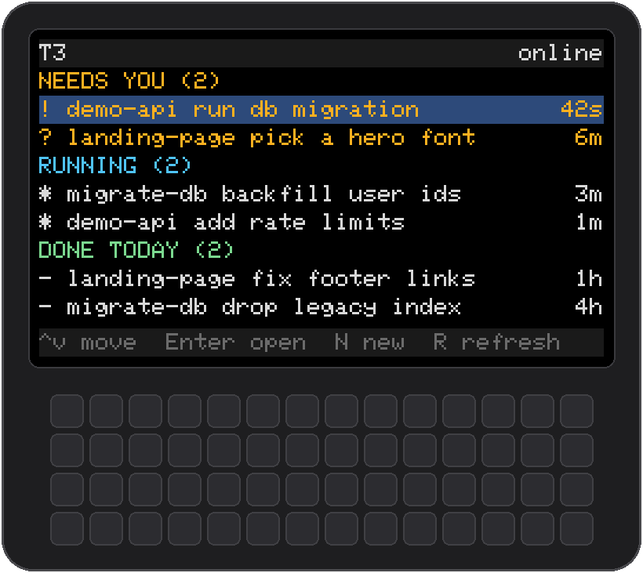
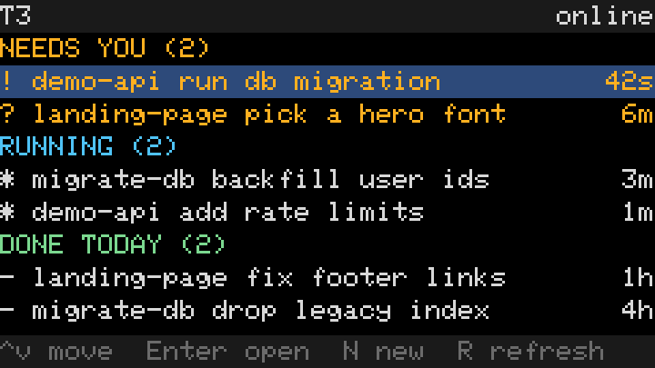
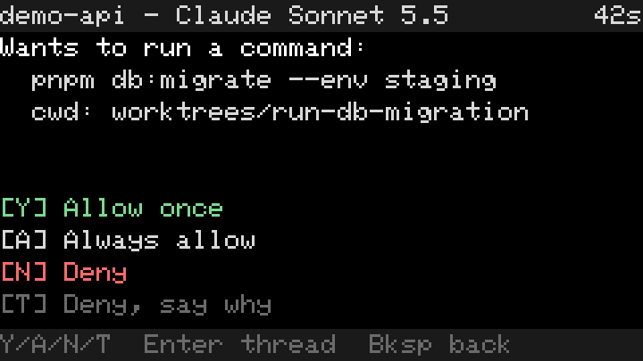
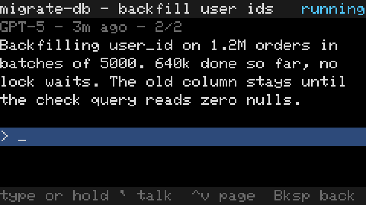
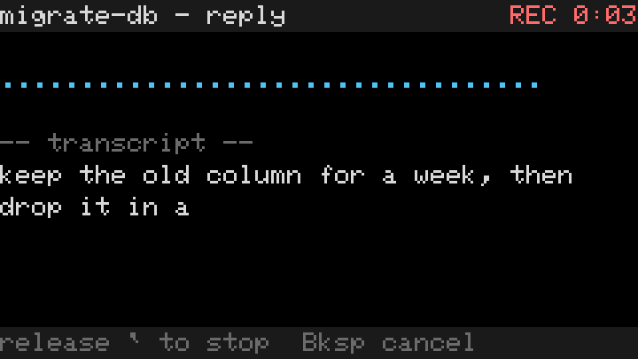
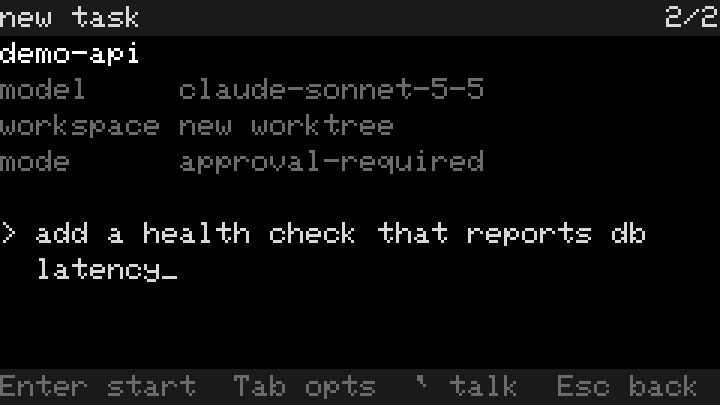
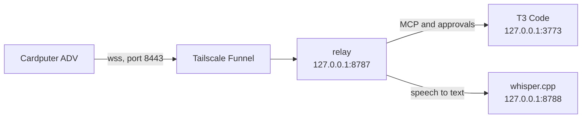

<p align="center"></p>

# T3 Cardputer

Your T3 Code agents on an M5Stack Cardputer ADV. Answer approvals, read and reply to threads, start new tasks and talk to them, away from your desk.

## Quickstart

1. On the machine where T3 Code runs:

   ```
   curl -fsSL https://t3-cardputer.jopcmelo.com/setup.sh | sh
   ```

2. Open the link it prints in Chrome or Edge.
3. Plug the ADV in over USB and click Connect ADV and install.

The page asks which WiFi the ADV should join. The ADV restarts, joins it and pairs by itself. Nothing to type on the device.

[docs/install.md](docs/install.md) has what the script does, step by step, and a manual path if you'd rather not pipe a script into a shell.

## Screens

| Home | Approval | Thread |
| --- | --- | --- |
|  |  |  |

| Voice | New task |
| --- | --- |
|  |  |

## Requirements

- An M5Stack Cardputer ADV and a USB-C data cable.
- T3 Code on a Mac or a Linux machine. Windows isn't supported yet.
- On that machine: Node 22 or newer, git, cmake (or `uv`, which setup uses to get one) and a C++ compiler (`xcode-select --install` on macOS).
- Tailscale, logged in, with Funnel allowed for that machine.
- Chrome or Edge on a desktop for the install page.
- A 2.4 GHz WiFi network for the ADV.

## How it works



The relay runs next to T3, on your machine. It turns threads into screen-sized pages, answers approvals and transcribes voice locally with whisper.cpp. The ADV only talks to the relay, through Funnel. T3's tokens never leave the relay's machine. [docs/security.md](docs/security.md) has the details.

## Keys

The arrows are Fn plus `;` `.` `,` `/`. Screens show them as `^v` and `<>`. Esc is Fn plus `` ` ``.

| Key | Does |
| --- | --- |
| Enter | Open the selected thread, send |
| Bksp | Back, or delete while typing |
| N | New task (on Home) |
| R | Refresh |
| Tab | Open the waiting approval or question |
| Y / A / N / T | Allow once, always allow, deny, deny and say why |
| 1 to 9 | Pick an answer to a question |
| Enter in a thread | Queue the reply for after the running turn |
| Fn+Enter in a thread | Steer the running turn with the reply |
| Hold `` ` `` | Talk. Release to stop |
| Fn+S | Setup: WiFi, relay URL, pairing |

[docs/using.md](docs/using.md) goes screen by screen.

## Docs

- [Install](docs/install.md)
- [Using it](docs/using.md)
- [Troubleshooting](docs/troubleshooting.md), keyed by the exact text on screen
- [Security](docs/security.md)
- [Development](docs/development.md)
- [Device protocol](docs/protocol.md)

MIT licensed, see [LICENSE](LICENSE).
