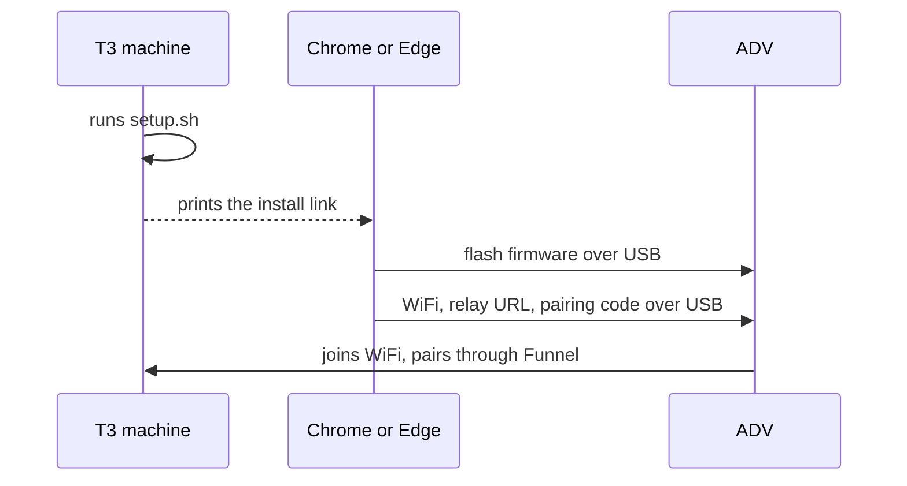

# Install

Three steps: a script on the machine where T3 Code runs, a web page that flashes the ADV over USB, and the ADV pairing by itself.



## 1. Run setup on the T3 machine

```
curl -fsSL https://t3-cardputer.jopcmelo.com/setup.sh | sh
```

Run it as your normal user, on the machine where T3 Code runs (macOS or Linux). It installs everything under your home directory and never runs sudo. When a step needs root, it stops and prints the command for you to run.

A fresh Linux run looks like this. It's the output of the setup test harness (`site/test/setup/run.sh`), so the version and host are fake:

```
✓ Linux x86_64
✓ Node 22.11.0
✓ Tailscale logged in
✓ T3 answers at http://127.0.0.1:3773
✓ Relay 9.9.9 installed, add ~/.local/bin to your PATH to run t3-cardputer-relay
Build voice for your NVIDIA GPU with CUDA? It needs the CUDA toolkit. [y/N]
✓ Voice built for CPU
✓ T3 paired
On each T3 update the relay runs one short agent turn to check approvals still work. It uses your usage. Enable? [y/N]
✓ Canary on, using claude-haiku-5-5
Turn on Tailscale Funnel on port 8443 so the ADV can reach the relay? [Y/n]
✓ Funnel on port 8443
✓ Relay service running (systemd user unit, starts at boot)
✓ Funnel answers at /healthz
✓ Install link ready, the code expires in 10 min
Plug in your ADV and open this in Chrome or Edge:
https://t3-cardputer.jopcmelo.com/install#r=https%3A%2F%2Ft3-box.example.com%3A8443&c=K7Q2AB9X
```

A check that fails prints a `✗` line with what's missing and `next:` with the command to run, then stops. [troubleshooting.md](troubleshooting.md#from-setupsh) lists them.

What it does, in order:

1. Checks the machine: Linux or macOS (Windows is refused), not root, Node 22 or newer, Tailscale logged in, and T3 answering at `http://127.0.0.1:3773`. Set `t3BaseUrl` in `~/.config/t3-cardputer/relay.json` if your T3 is elsewhere.
2. Downloads the relay from the GitHub release the script pins, checks every file against the release's `SHA256SUMS`, installs it in `~/.local/share/t3-cardputer/releases/<version>` and links `~/.local/bin/t3-cardputer-relay` to it.
3. Builds voice: whisper.cpp in `~/.local/share/t3-cardputer/whisper`, and downloads the `small.en`, `medium.en` and `large-v3-turbo` models next to it. On my machine `du -sh` says `models/` is 3.4G and `whisper/` is 70M. On Apple Silicon it asks about Metal, default yes. On Linux with an NVIDIA GPU it asks about CUDA (that needs the CUDA toolkit), default no. On a re-run the default is what you built last time. Everything else builds for the CPU.
4. Pairs the relay with T3. With the `t3` CLI on PATH it runs `t3 auth pairing create` twice itself. Without it, it prints that command and asks you to paste the two credentials (input is hidden). The tokens land in `~/.config/t3-cardputer/secrets.json`, mode 0600.
5. Asks about the canary, default no. When T3 updates, the canary runs one short agent turn to check that approvals still work, and that turn uses your T3 usage. If you say yes, it picks a small model (`haiku`, `mini` or `flash` in the id) from the ones your T3 has, or asks you to pick one.
6. Turns on Tailscale Funnel on port 8443, after asking, and saves the URL as `publicUrl` in `relay.json`. It needs HTTPS certificates on in your tailnet, and on Linux it needs you to be the Tailscale operator once: `sudo tailscale set --operator=$USER`. Never 443: on 443 Funnel takes over the tailnet address, and anything else serving https there (a reverse proxy, say) stops working.
7. Installs and starts the service and waits up to 30 seconds for `/healthz`. On Linux that's a systemd user unit plus `loginctl enable-linger`, so it starts at boot and keeps running after you log out. On macOS it's a launchd agent, which runs while you're logged in.
8. Checks that the Funnel URL answers `/healthz`, for up to 2 minutes. A new Funnel can take longer to get its certificate and DNS, so a timeout prints a `!` warning and setup goes on.
9. Prints the install link. On battery power it also says the machine must stay awake. A laptop that sleeps takes the relay with it.

Running it again is safe. It keeps your config, tokens that haven't expired, the canary choice and Funnel, and updates the relay in place.

Flags (piped, they go after `sh -s --`):

```
curl -fsSL https://t3-cardputer.jopcmelo.com/setup.sh | sh -s -- --dry-run
```

- `--dry-run` runs the checks and prints what it would do. It writes nothing.
- `--yes` takes the default for every question.
- `--update` updates an installed relay in place, takes the default for every question like `--yes`, and prints no install link.

If the machine already runs a self-repairing checkout (`repair.projectId` in `relay.json`), setup refuses to touch it. See [run from a git checkout](#run-from-a-git-checkout).

## 2. Flash the ADV

Plug the ADV into a computer with Chrome or Edge, and open the link setup printed. Safari, Firefox and phones can't talk to USB devices, and the page says so.

The link carries your relay URL and a pairing code after the `#`. Browsers never send that part to the server. [security.md](security.md) has more.

1. Read the warning: this replaces everything on the ADV, Launcher included.
2. Leave clean install off to keep the ADV's WiFi, relay and pairing. On erases them first.
3. Click Connect ADV and install, then pick the ADV's port. The page downloads the firmware, checks each part's sha256, writes it, checks it again on the ADV and restarts it.
4. Type the WiFi network the ADV should join (2.4 GHz only) and click Send to ADV. If the ADV already has networks saved, you can leave the name empty to keep them. The network name, password, relay URL and pairing code go to the ADV over USB, nowhere else.

The pairing code works for 10 minutes. If it runs out, run `t3-cardputer-relay install-link` for a new link.

## 3. The ADV pairs by itself

It restarts, joins the WiFi, trades the code for a device token and opens Home. If it shows something else, look the text up in [troubleshooting.md](troubleshooting.md).

Without a link you can type the relay URL on the ADV instead (Fn+S, then the `relay` row). On the relay's machine, `tailscale funnel status` shows it, and so does `publicUrl` in `~/.config/t3-cardputer/relay.json`. Then pair with a code from `t3-cardputer-relay pair`.

## Updating

Each change to the relay, firmware or site on `main` cuts a release. Your relay never updates itself and never calls home. When something needs an update, Home tells you which command to run.

- Relay: `t3-cardputer-relay update`. It downloads the latest `setup.sh` and runs it with `--update`.
- ADV: `t3-cardputer-relay install-link`, open the link and install with clean install off. WiFi, relay URL and pairing stay.
- T3 tokens: they expire after 30 days and don't refresh. Home warns 5 days ahead. `t3-cardputer-relay renew` makes new ones.

## Manual install

The same steps by hand, for when you'd rather not pipe a script into a shell. Pick a version from the [releases](https://github.com/joaopcm/t3-cardputer/releases).

Download and check the relay:

```
VERSION=<x.y.z>
DIR=~/.local/share/t3-cardputer/releases/$VERSION
mkdir -p "$DIR" && cd "$DIR"
for f in t3-cardputer-relay.mjs install-whisper.sh t3-cardputer-relay.service com.t3-cardputer.relay.plist SHA256SUMS; do
  curl -fsSLO "https://github.com/joaopcm/t3-cardputer/releases/download/v$VERSION/$f"
done
grep -E ' (t3-cardputer-relay\.mjs|install-whisper\.sh|t3-cardputer-relay\.service|com\.t3-cardputer\.relay\.plist)$' SHA256SUMS | shasum -a 256 -c
```

Every line has to say `OK`. Then link it:

```
chmod 755 t3-cardputer-relay.mjs
ln -sfn "releases/$VERSION" ~/.local/share/t3-cardputer/current
mkdir -p ~/.local/bin
ln -sfn ~/.local/share/t3-cardputer/current/t3-cardputer-relay.mjs ~/.local/bin/t3-cardputer-relay
t3-cardputer-relay --version
```

Build voice. `--gpu` takes `none`, `cuda` or `metal`:

```
bash install-whisper.sh --gpu none
```

Pair with T3. `renew` makes both tokens with the `t3` CLI. Without `t3` on PATH it prints the two commands to run where T3 runs, and how to hand the credentials to `t3-cardputer-relay pair-t3 --stdin`:

```
t3-cardputer-relay renew
```

Turn on Funnel. 8787 is the relay's default port:

```
tailscale funnel --bg --https=8443 8787
tailscale funnel status
```

The status shows the public URL, `https://<machine>.<tailnet>.ts.net:8443`. Your tailnet policy needs the `funnel` node attribute for this machine, or the command tells you to turn it on.

Write `~/.config/t3-cardputer/relay.json`. Only set what you change, the defaults live in `relay/src/config.ts` and `relay/relay.example.json` shows every key. Unknown keys and bad values stop the relay at start and name the key.

```json
{ "publicUrl": "https://<machine>.<tailnet>.ts.net:8443", "canary": { "enabled": false } }
```

```
chmod 600 ~/.config/t3-cardputer/relay.json
```

To turn the canary on, pick a cheap model from `t3-cardputer-relay models` (it prints `id  label  (providerInstanceId)`) and set `"canary": { "enabled": true, "model": "<id>", "providerInstanceId": "<providerInstanceId>" }`.

Start the service on Linux:

```
mkdir -p ~/.config/systemd/user
sed -e "s|__NODE__|$(node -p process.execPath)|" \
    -e "s|__BUNDLE__|$HOME/.local/share/t3-cardputer/current/t3-cardputer-relay.mjs|" \
    t3-cardputer-relay.service > ~/.config/systemd/user/t3-cardputer-relay.service
systemctl --user daemon-reload
systemctl --user enable --now t3-cardputer-relay
loginctl enable-linger "$USER"
```

Or on macOS:

```
mkdir -p ~/Library/LaunchAgents ~/Library/Logs/t3-cardputer
sed -e "s|__NODE__|$(node -p process.execPath)|" \
    -e "s|__BUNDLE__|$HOME/.local/share/t3-cardputer/current/t3-cardputer-relay.mjs|" \
    -e "s|__LOG_DIR__|$HOME/Library/Logs/t3-cardputer|" \
    com.t3-cardputer.relay.plist > ~/Library/LaunchAgents/com.t3-cardputer.relay.plist
launchctl bootstrap "gui/$(id -u)" ~/Library/LaunchAgents/com.t3-cardputer.relay.plist
```

Check it's up, then print the install link and go to [step 2](#2-flash-the-adv):

```
curl -s http://127.0.0.1:8787/healthz
t3-cardputer-relay install-link
```

`/healthz` answers `ok`. `install-link` needs the relay running and `publicUrl` set.

## Run from a git checkout

This is how my relay runs: a clone that tracks `main`, with self-repair on. When the canary finds approvals broken after a T3 update, the relay launches a T3 thread that fixes the adapter and opens a PR against this repo. The relay merges it with my GitHub token once CI and a staging canary pass. That only makes sense for this repo's owner, so self-repair stays off for everyone else. You can still run from a checkout without it.

You need git access to the repo without a prompt, Node 22, pnpm and `~/.local/bin` on your PATH.

```
git clone https://github.com/joaopcm/t3-cardputer.git ~/.local/share/t3-cardputer/deploy
cd ~/.local/share/t3-cardputer/deploy/relay
pnpm install --frozen-lockfile
pnpm build
./scripts/install-whisper.sh
mkdir -p ~/.local/bin
ln -sf ~/.local/share/t3-cardputer/deploy/relay/dist/cli.js ~/.local/bin/t3-cardputer-relay
t3-cardputer-relay renew
```

Funnel and `relay.json` are the same as in the manual install. The service uses the checkout's unit, which runs `dist/cli.js` from the clone:

```
mkdir -p ~/.config/systemd/user
cp ~/.local/share/t3-cardputer/deploy/relay/deploy/t3-cardputer-relay.service ~/.config/systemd/user/
systemctl --user daemon-reload
systemctl --user enable --now t3-cardputer-relay
loginctl enable-linger "$USER"
journalctl --user -u t3-cardputer-relay -f
```

Stop waits up to 240 s, because a canary can be mid-run. The receipt is in the unit file.

Self-repair needs three more things.

1. The repo as a T3 project, so the repair thread can run in it. From a T3 thread with the MCP tools: `t3_project_create` with the clone's path, `t3_project_list` for its id, then `"repair": { "projectId": "<id>" }` in `relay.json`. Without it repair refuses to start and says so. With it, the canary defaults to on.
2. A fine-grained GitHub token, resource owner the repo owner, only repo `joaopcm/t3-cardputer`, with Contents read and write, Pull requests read and write, Checks read, Commit statuses read. Paste it on stdin (hidden on a terminal):

   ```
   t3-cardputer-relay secrets set github
   ```

3. Branch protection on `main` that requires the `test` check from `.github/workflows/ci.yml`. Repair merges only when the checks in `repair.requiredChecks` (default `["test"]`) passed. 15368 is the GitHub Actions app id:

   ```
   gh api -X PUT repos/joaopcm/t3-cardputer/branches/main/protection --input - <<'JSON'
   {
     "required_status_checks": { "strict": true, "checks": [{ "context": "test", "app_id": 15368 }] },
     "enforce_admins": false,
     "required_pull_request_reviews": null,
     "restrictions": null
   }
   JSON
   ```

   `strict` is "require branches up to date". Don't turn the `test` job into a matrix, that renames the check.

`t3-cardputer-relay canary` runs the approvals check once by hand. Exit 0 means approvals work against the current T3.
